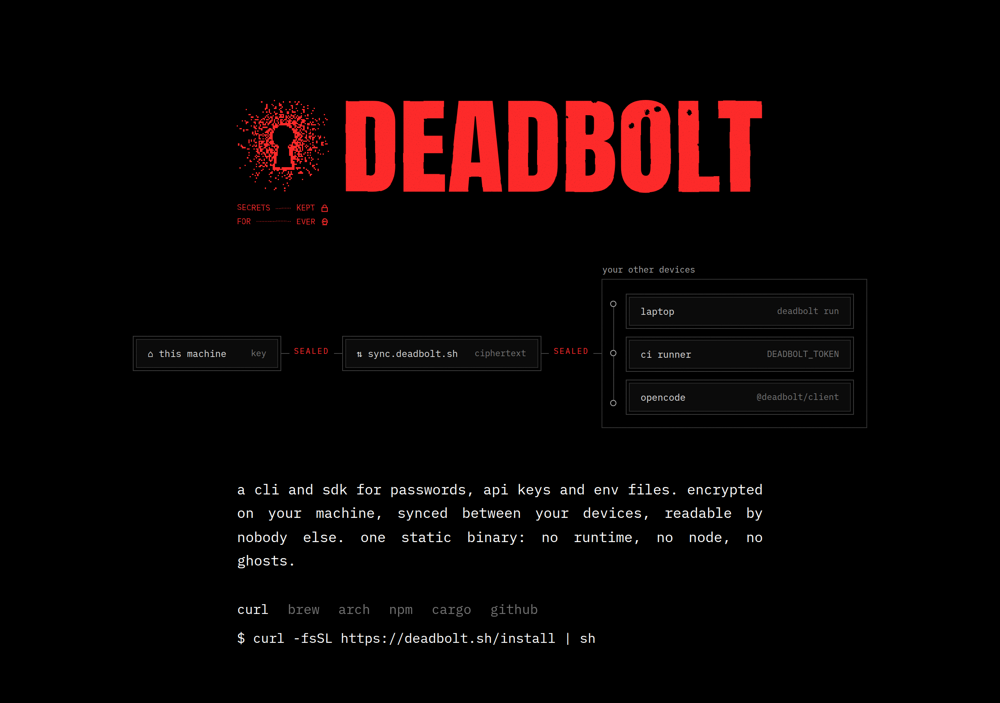

# deadbolt

A decentralized password manager, in Rust. Your devices sync directly with each other over [iroh](https://www.iroh.computer); a new device joins only by pairing from one you already have. No accounts, no servers of our own.

Status: alpha. Every push to `dev` ships a build; there is no stable release yet.

## Install

Deadbolt comes as a CLI, a desktop app and a browser extension. Install the app or CLI, create a vault, then add the extension and your other devices. The standalone extension can also run on its own.

### The app and CLI

There is no stable release yet, so install the latest build of `dev`:

```sh
curl -fsSL https://deadbolt.pw/install | DEADBOLT_CHANNEL=dev sh
```

The script installs `deadbolt` to `~/.local/bin` (set `DEADBOLT_INSTALL` to change it) and checks its SHA-256. It works on macOS and Linux, x64 and arm64. On macOS you can get the app instead: [Deadbolt.app (dev)](https://anoma.ly/release/deadbolt/desktop/dev/macos-arm64-dmg), a universal build.

Once stable releases start, the script installs stable by default (`DEADBOLT_VERSION` pins one), and Homebrew and [GitHub releases](https://github.com/anomalyco/deadbolt/releases) get them too:

```sh
brew install anomalyco/tap/deadbolt          # the CLI
brew install --cask anomalyco/tap/deadbolt   # Deadbolt.app for macOS, with its CLI
```

Run `deadbolt` in a terminal for the CLI, or `deadbolt app` (or Deadbolt from Applications, Spotlight or your launcher) for the app. Bare `deadbolt` started outside a terminal opens the app too; set `DEADBOLT_NO_UI=1` in scripts that must never get a window. On Linux, `deadbolt desktop install` adds Deadbolt to the app launcher; the app's program, `deadbolt-ui`, goes beside `deadbolt` or in `<prefix>/lib/deadbolt/` (Linux releases ship only the CLI).

### First run

On your first device, create a vault:

```sh
deadbolt init
```

Or open the app and choose **Create a vault**.

To add another device, start on the new one and finish on one that has the vault:

```sh
deadbolt join          # on the new device: shows a code
deadbolt pair <code>   # on a device with the vault
```

In the app, the new device's **Join from another device** does the same. A code works once, for 5 minutes.

### The browser extension

The extension works in Chromium-based browsers: Chrome, Brave, Arc, Edge, Chromium and Helium. It isn't in the Chrome Web Store yet, so you load it unpacked. It comes in two builds:

- **Regular:** fills from the Deadbolt app or CLI on the same computer.
- **Standalone:** its own Deadbolt device, with its own copy of the vault. No app or CLI needed.

Both builds have the same extension ID, so use one of them per browser profile.

**Regular build.** With Deadbolt installed, connect your browsers and pick a new, empty folder for the extension:

```sh
deadbolt browser install --extension-dir ~/deadbolt-extension
deadbolt update        # downloads the extension into that folder
```

Then load it:

1. Open `chrome://extensions` and turn on **Developer mode**.
2. Click **Load unpacked** and choose the folder.
3. After each `deadbolt update`, click reload on Deadbolt there.

**Standalone build.**

1. Download [the zip](https://anoma.ly/release/deadbolt/extension/dev/chromium-standalone) and unzip it.
2. In `chrome://extensions`, turn on **Developer mode**, click **Load unpacked** and choose the unzipped folder.
3. Choose **Pair with an existing device** (then run `deadbolt pair <code>` on a device with your vault) or **Create a new vault**.

An unpacked extension can't update itself. To update by hand, download the zip again and put it in place of the old folder. With the CLI installed, let it keep a folder current instead, and load that folder:

```sh
deadbolt browser install --standalone --extension-dir ~/deadbolt-extension
deadbolt update        # downloads it now, and every later release
```

A folder registered for one build can switch to the other with `deadbolt browser switch --standalone` (or `--native`); then reload Deadbolt in `chrome://extensions`.

Found a problem? In the standalone build, use **Settings → Report an issue**; otherwise [open an issue](https://github.com/anomalyco/deadbolt/issues).

### Updating

```sh
deadbolt update
```

This updates Deadbolt.app or the `deadbolt` it runs from, and every extension folder registered with `deadbolt browser install --extension-dir`. Reload the extension afterwards. Homebrew installs update with `brew upgrade`. Releases: [`docs/releasing.md`](docs/releasing.md).

### Not available yet

The mobile apps (iOS and Android) are in progress, and Safari AutoFill on macOS isn't in releases yet.

## Secrets for commands

Put secrets in a command's environment or a file instead of printing them. A reference is `deadbolt://[vault/]item/field`, the item by its title or short id:

```sh
deadbolt run --env GH_TOKEN=deadbolt://personal/GitHub/token -- gh release create v1
deadbolt run --env-file .env.tpl -- bun run dev       # KEY=deadbolt://… lines
deadbolt inject -i config.tpl -o config.json          # {{ deadbolt://… }}, written 0600
deadbolt read deadbolt://personal/GitHub/password     # prints one value
```

`run` conceals the values in the command's output (so the command's output is a pipe, not your terminal: `--no-mask` keeps the terminal), passes stdin and signals through and exits with the command's code. AI agents (OpenCode, Claude Code and the like) are refused until you allow them, item by item. Allowing an AI to use a value lets it learn the value (it chooses the command, and masking only stops accidents), so allow only what you would hand it. Printing a value, with `read` or `inject` to stdout, needs Touch ID every time:

```sh
deadbolt agents allow-secrets GitHub --fields token --purpose run --expires 8h
deadbolt agents grants                     # deadbolt agents revoke <id>
deadbolt activity                          # every resolve, never a value
```

## Docs

- [`docs/design.md`](docs/design.md) — **the current v1 design** (two keys, signed membership, per-device encrypted logs, QR pairing).
- [`docs/app.md`](docs/app.md) — the desktop app (Rune, in `crates/app`): plan, keyboard, motion, and the first slice.
- [`docs/proposals/send.md`](docs/proposals/send.md) — Deadbolt Send: one-time links to files, secrets and vault items, served live peer to peer and opened in any browser.
- [`docs/autofill.md`](docs/autofill.md) — browser autofill: the native messaging host, its message set, domain rules and threat model.
- [`docs/agent-control.md`](docs/agent-control.md) — design: how AI agents may use Deadbolt (tiers, Touch ID approvals, caller identity), what is built of it: `deadbolt run`, `inject` and `read` with grants for AI agents, and standing grants for sign-ins: `deadbolt agents` pairs a browser relay such as Browse and allows it to sign AI agents in to chosen sites unattended, without the AI ever seeing a value.
- `docs/research/` — prior art
  - [`01-inkandswitch.md`](docs/research/01-inkandswitch.md) — Keyhive, BeeKEM, Beelay/Subduction, Automerge
  - [`02-rust-sync-stacks.md`](docs/research/02-rust-sync-stacks.md) — iroh, p2panda, Willow, Loro/Automerge/yrs
  - [`03-mailbox-pairing-keys.md`](docs/research/03-mailbox-pairing-keys.md) — mailboxes (Nostr, S3, folders), pairing, how other password managers handle keys and recovery
- `docs/history/` — how we got here: the v0 proposal, the no-infrastructure (Nostr mailbox) revision, and two adversarial critiques of them. Superseded by `docs/design.md`; kept for the reasoning. These docs reference the research files by bare filename.

## Site

`site/` is the website: a landing page (`/`) and an animated architecture walkthrough (`/architecture/`), in the style of opentunnel.xyz (Vite, React, Motion, WebGL2 prints; fonts are Anton and IBM Plex Mono, OFL, licences in `site/public/fonts/`). `cd site && bun install && bun run dev` serves it on http://127.0.0.1:5197. `bun run deploy` builds it and deploys `site/dist` to deadbolt.pw with Wrangler; `site/public/install` is the install script served at `/install`. `/r` is Deadbolt Send's receive page; building the site first compiles its WebAssembly (`site/scripts/wasm.sh`, which needs the `wasm32-unknown-unknown` target and `wasm-bindgen-cli`, see `docs/proposals/send.md`). The original static mock is kept at [`site/mock.html`](site/mock.html).


