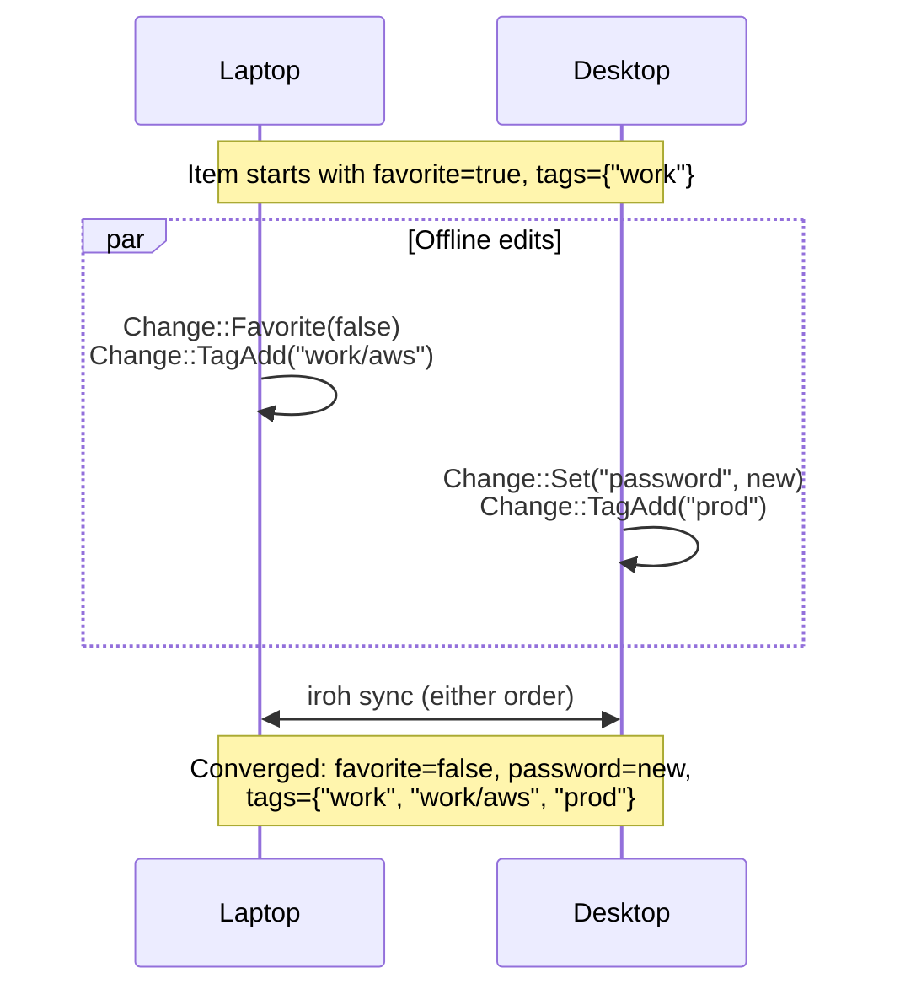

# Favorites and tags

2026-10-30. Plan for starring items and organizing them with tags (including nested paths such as `work/aws`), matching 1Password across the core log, imports, 1Password sync, CLI, desktop app, quick panel, and browser extension.

Favorites and tags live on `Item` inside the signed data log, encrypted at rest in `store.redb` and in transit over iroh like every other item datum. `favorite` resolves as a causal boolean register, and `tags` resolves as a per-tag add-wins Observed-Remove Set, so two devices adding different tags or one unstarring while another edits a password converge without losing work. Every importer (`.1pux`, 1Password CSV, Bitwarden `.json`) and `deadbolt sync 1password` carry favorites and tags or folders over instead of dropping them. Control protocol 20 exposes both to the CLI, desktop app, quick panel, and browser extension, where favorites rank first and `#work` filters to `work` and every tag nested under `work/`.

## Open decisions

Each item below states the recommended default used in this plan and the main alternative.

1. **Favorites in the sidebar and quick panel: flat list sorted first vs. a separate "Favorites" section.**
   - **Recommended:** Keep one flat virtualized list with favorites sorted ahead of other items (`(!favorite, label, id)`) and a small muted star beside a favorite's title. Every row stays 46 pt (`vault::ROW_H`), O(1) virtual-scroll math holds, `⌘1–9` jumps straight to your top nine favorites when search is empty, and no section headers or dividers break the list.
   - **Alternative:** Split the unfiltered sidebar into "Favorites" and "All items" sections with header rows.

2. **Keyboard shortcut to star or unstar the selected item: `⌘D` vs. `⇧⌘F`.**
   - **Recommended:** `⌘D` (Ctrl+D off macOS). Every existing chord in `crates/app/src/keys.rs` and `edit.rs` leaves `⌘D` free (`Delete` is `⌘⌫`), Rune's focused search `TextEdit` does not claim `⌘D`, and the single-modifier chord matches browser bookmarking. Also expose Favorite / Unfavorite in `⌘K` Actions and as a star icon button in the item toolbar.
   - **Alternative:** `⇧⌘F`, paired mnemonically with `⌘F` (Search). `⇧⌘F` is also unbound everywhere in the app.

3. **Tag casing and spaces: case-preserving with case-folded matching vs. lowercase slugs.**
   - **Recommended:** Preserve display case (`Work/AWS`, `Tax 2026`), deduplicate and match case-insensitively (`#work/aws` matches `Work/AWS`), trim `/` segments, and accept both `#"Tax 2026"` and hyphenated `#tax-2026` in search. Imported 1Password tags and Bitwarden folders keep the names users gave them.
   - **Alternative:** Normalize every tag to lowercase hyphenated slugs (`work/aws`, `tax-2026`) on write and import so every tag is an unquoted `#token`.

4. **CLI surface for starring and tagging: flags on `new` / `set` / `ls` vs. top-level verbs.**
   - **Recommended:** Add `--favorite` / `--no-favorite`, `--tag`, and `--untag` to `deadbolt set` (matching `--name`, so field edits, renames, tags, and favorite changes commit in one signed entry), `--favorite` and `--tag` to `deadbolt new`, `--tag` and `--favorites` to `deadbolt ls` (aliased as `deadbolt items`), plus `deadbolt tags` to list tags with counts.
   - **Alternative:** Add dedicated top-level `deadbolt star` / `unstar` and `deadbolt tag` / `untag` subcommands alongside or instead of `set` flags.

5. **Bitwarden folders and collections on import: map to tags vs. drop.**
   - **Recommended:** Map each item's `folderId` (`folders[].name`) and organization `collectionIds` (`collections[].name`) to tags. Bitwarden uses `/` in folder names for hierarchy (`Work/AWS`), which maps directly to nested Deadbolt tags.
   - **Alternative:** Import `favorite` only and keep dropping Bitwarden folders.

---

## 1. Data model and convergence (`crates/core`)

### Synced item state, not per-device metadata

Both `favorite: bool` and `tags: BTreeSet<String>` belong on `deadbolt_core::Item` in the signed data log (`Log::Data`):

- Deadbolt v1 vaults model one user's devices (`DeviceId`, no `UserId`). Pairing a laptop, phone, or standalone browser (`deadbolt join`), or running `deadbolt sync 1password` on one Mac, must bring stars and tags to every other device through normal sync.
- Keeping them in signed entries binds every star and tag write to an active member's Ed25519 signature, applies membership removal cutoffs (`Remove.last_seen_seq`) automatically during `Vault::rebuild_items`, and records changes in `Vault::history`.

### New `Change` variants and `Create` tag `0x03`, not item `fields`

`favorite` and `tags` must stay separate from `Item.fields` (`BTreeMap<String, Field>`), for the same reasons `name` and `source` do (`crates/core/src/entry.rs`):

1. **No field-name collisions.** An item can already hold an imported extra field named `favorite` or `tags`.
2. **No secret/field surface leaks.** Clients iterate `item.fields` to draw copyable field rows, resolve `deadbolt://vault/item/field` references, and build `deadbolt send --item` bundles. Stars and tags are item metadata, not copyable values.
3. **Granular convergence.** Storing tags as one comma-joined text field would turn the whole tag set into a single register where concurrent additions overwrite each other.

In `crates/core/src/entry.rs`, extend `DataOp::Create` and `Change`:

```rust
pub enum DataOp {
    Create {
        kind: String,
        name: Option<String>,
        fields: BTreeMap<String, Field>,
        source: Option<Source>,
        favorite: bool,
        tags: BTreeSet<String>,
    },
    Edit { item: ItemId, change: Change },
}

pub enum Change {
    Set { field: String, value: Field },
    Remove { field: String },
    Name(Option<String>),
    Delete,
    Source(Option<Source>),
    /// Stars (`true`) or unstars (`false`) the item.
    Favorite(bool),
    /// Adds one normalized tag (`work`, `work/aws`).
    TagAdd(String),
    /// Removes one tag (matched case-insensitively).
    TagRemove(String),
}
```

`DataOp::Create` carries initial `favorite` and `tags` directly because an item's `ItemId` is derived from the `Create` entry's hash (`ItemId::of_create(&entry.hash(), index)`). An item created by `deadbolt new`, an import, or `sync 1password` cannot be edited in the same entry before its hash exists; carrying both on `Create` keeps single-entry atomic creation without a follow-up entry batch.

To keep existing vaults and test fixtures byte-identical, `Create` uses a new wire tag `0x03` **only** when `favorite || !tags.is_empty()`:

```text
data_op = 0x00 type:str opt_str n:u32 (name:str field)*n                        Create (plain)
        | 0x01 item[16] change                                                   Edit
        | 0x02 type:str opt_str n:u32 (name:str field)*n source_id:str ver:str   Create (mirror)
        | 0x03 type:str opt_str n:u32 (name:str field)*n opt_source fav:u8
               m:u32 tag:str*m                                                   Create (with fav/tags)

change  = 0x00 name:str field      Set
        | 0x01 name:str            Remove
        | 0x02 opt_str             Name
        | 0x03                     Delete
        | 0x04 opt_source          Source
        | 0x07 fav:u8              Favorite (0x00 false | 0x01 true; 0x05..=0x06 reserved for delete/restore)
        | 0x08 tag:str             TagAdd
        | 0x09 tag:str             TagRemove
```

Canonical decoding (`Entry::decode`) enforces one valid encoding per entry:
- `fav` accepts only `0` or `1` (`DecodeError::InvalidTag` otherwise).
- In `Create` (`0x03`), `tags` must be strictly ascending (`last >= tag` returns `DecodeError::NotCanonical`), and `!favorite && tags.is_empty()` returns `DecodeError::NotCanonical` because that op belongs on `0x00` or `0x02`.
- Every existing stored entry in `store.redb` and `vault.redb` decodes with the same hash, signature, and `ItemId`.

### CRDT rules: causal register for `favorite`, add-wins OR-Set for `tags`

`crates/core/src/data.rs` already tracks per-register causal frontiers (`Vec<Write<T>>`) using each `Node`'s vector clock (`Write::superseded_by`). Both new fields reuse `Write<T>` directly:

- **`favorite: Vec<Write<bool>>` (causal LWW register, default `false`).**
  - `Change::Favorite(b)` drops every `Write<bool>` in `self.favorite` that it causally saw and pushes `b`.
  - Current value: `winner(&self.favorite).is_some_and(|w| w.value)`, where `winner` breaks ties among truly concurrent writes by highest `(entry_hash, op_index)`.
- **`tags: BTreeMap<String, Vec<Write<Option<String>>>>` (per-tag add-wins Observed-Remove Set).**
  - Keys in `self.tags` are case-folded tag paths (`fold_tag(tag)`).
  - `Change::TagAdd(tag)` writes `Some(tag)` to `self.tags[fold_tag(&tag)]`, superseding prior writes on that key in its causal past.
  - `Change::TagRemove(tag)` writes `None` to `self.tags[fold_tag(&tag)]`, superseding only the adds and removes in its causal past.
  - Current presence for a bucket: **add wins** (`frontier.iter().any(|w| w.value.is_some())`), matching how `ItemState.alive` resolves concurrent edits against `Change::Delete`. When present, the display spelling comes from the highest `(entry_hash, op_index)` `Some(spelling)` in the frontier, so `Item.tags` (`BTreeSet<String>`) is deterministic in every arrival order.



How concurrent cases resolve:

| Concurrent edits | Outcome | Why |
|---|---|---|
| Device A adds `work/aws`; Device B adds `prod` | Both tags kept (`work/aws`, `prod`) | Distinct keys in `ItemState.tags`; zero conflict |
| Device A adds `aws`; Device B removes `work` | `aws` added, `work` removed | Distinct keys in `ItemState.tags` |
| Device A adds `aws`; Device B concurrently removes `aws` | `aws` kept; B's remove is `Conflicted` in `history` | Add-wins OR-Set: B had not observed A's `TagAdd` |
| Device A removes `aws` after syncing A and B | `aws` removed; prior writes `Superseded` | Causal `superseded_by` clears the frontier |
| Device A unstars (`Favorite(false)`); Device B edits `password` or tags | Unstarred **and** new password/tags kept | `favorite`, `fields`, and `tags` are independent frontiers; edit forms emit only changed registers |
| Device A stars (`true`); Device B concurrently unstars (`false`) | Higher `(entry_hash, op_index)` wins; loser is `Conflicted` | Deterministic register tie-break |
| Device A deletes item; Device B stars or tags it | Item stays alive (`!deleted`) with B's change | Matches `data.rs`'s existing `alive` rule for all non-`Delete` edits |

### Tag rules and nested hierarchy (`crates/core/src/tag.rs`)

- **Normalization (`normalize_tag`)**: strips an optional leading `#`, splits on `/`, collapses internal whitespace runs in each segment to single spaces, trims each segment, and rejoins with `/`. `" #work / aws "` becomes `"work/aws"`.
- **Validation (`valid_tag`)**, enforced at `Vault::write` and `Vault::apply`:
  - 1 to 128 Unicode characters (`MAX_TAG_LEN = 128`), no control characters, does not start with `#`.
  - Every `/`-separated segment is non-empty and trimmed (rejects `""`, `"/work"`, `"work/"`, `"work//aws"`, `"work / aws"`).
- **Per-item cap (`MAX_TAGS = 64`)**: enforced on `DataOp::Create` everywhere and on edits in `Vault::write` (`data::check_tags`, mirroring `data::check_files`), while `Vault::apply` skips the count cap so concurrent tag additions from offline devices stay order-independent.
- **Empty-item rule (`ItemError::Empty`)**: `Create` still requires `name.is_some() || !fields.is_empty()`. Starring or tagging alone cannot create a blank item with neither a name nor a field.
- **Prefix matching (`tag_matches(item_tag, filter)`)**: case-folded segment match. Filter `work` matches `work`, `work/aws`, and `work/aws/prod`, and never matches `network` or `coworker`.

### Property and simulation cases

1. **Core property tests (`crates/core/src/tag_tests.rs`, `PROPTEST_CASES`)**:
   - Multi-device random DAGs mixing `Create` (with and without `favorite`/`tags`), `Favorite`, `TagAdd`, `TagRemove`, `Set`, `Remove`, `Name`, `Delete`, and device `Remove` cutoffs, replayed across random topological sorts (`assert_order_independent`) to check that both `Vault::items` and `Vault::history` match in every order.
   - Canonical encode/decode round-trips and rejection of non-canonical `Create` (`0x03` with `favorite = false` and empty `tags`, unsorted or duplicate tags, invalid `fav` byte).
   - Hierarchy matching (`work` vs. `work/aws` vs. `network`) and case-folded deduplication (`Work/AWS` + `work/aws`).
2. **Four-device deterministic simulator (`crates/cli/src/agent/sim/mod.rs`)**:
   - Add `Action::Favorite(usize, bool)`, `Action::Tag(usize, u64)`, and `Action::Untag(usize, u64)` driving `agent::items::set`.
   - `Action::Tag` formats nested tags containing `SECRET_MARKER` (`format!("work/{SECRET_MARKER}{value:016x}")`).
   - `World::check()` and `World::converge()` then verify across crashes, locks, partitions, half-open stream cuts, injected write failures, and mid-sync device removals:
     - **Encrypted disk:** no file in `d.dir` ever contains `SECRET_MARKER` in plaintext.
     - **Removal confidentiality:** outgoing wire bytes to a removed device never carry post-removal tag or favorite entries.
     - **Durability & watch coverage:** crash/reopen preserves heads and items; batches that only change tags or favorites still emit `Change::Items { vault }`.
     - **Convergence:** `Item`'s `PartialEq` includes `favorite` and `tags`, so `converged()` proves all active members reach identical stars and tag sets.

---

## 2. Encryption and metadata confidentiality

Tag names and favorite flags have the same confidentiality boundary as item names and secret values:

- **At rest (`crates/store` and OPFS):** `Unlocked::append_batch` seals each encoded `Entry` as one `XChaCha20-Poly1305` ciphertext in `store.redb`'s `LOG` table (`vault.redb` on OPFS) under `keys.data`. No secondary redb table or metadata key indexes tags or favorites; filtering scans the unlocked `Vault`'s in-memory items. Nothing on disk reveals tag names, how many tags exist, or which items are starred.
- **In memory and on lock:** `Entry::encode()` returns `Zeroizing<Vec<u8>>`. Locking the agent drops `Loaded` (and every `Vault` and `Item`); in the desktop app and quick panel, `App::forget_items` clears `items`, `detail`, `cache`, `edit`, and `search` on lock or close.
- **In transit (`crates/net`):** entries move only over iroh QUIC connections authenticated to current members' Ed25519 keys after the membership gate passes.
- **Browser autofill boundary (`SiteLogins`, `FormItems`, `PasskeyList`, `AgentLogins`):** web-page autofill and paired AI-agent login listings never receive `tags`. Ranking uses `item.favorite` inside the Rust agent (`deadbolt-core`), returning candidates already ordered without exposing organizational tags to the browser host or AI callers.
- **Activity log and errors:** `deadbolt activity` records command tiers (`item-list`, `item-set`) and item titles/fields as today (sealed in `store.redb`), never tag query strings in unencrypted logs; import and parse errors never quote raw export lines.

---

## 3. Import and 1Password sync

### What exports carry today (and what Deadbolt currently drops)

| Source | Favorite field in source | Tags / folders in source | Current behavior | Planned behavior |
|---|---|---|---|---|
| 1Password `.1pux` (`import/onepassword.rs`) | `item.favIndex` (`> 0` is starred) | `item.overview.tags` (`["work", "dev"]`, `/` for nested) | Dropped and counted (`FAVORITE`, `TAG`) | Set `Imported.favorite` and `Imported.tags`; stop counting as dropped |
| 1Password CLI `op` (`import/op.rs`) | `item.favorite` (`bool`, mapped to `favIndex` in `to_1pux`) | `item.tags` (`string[]`, mapped to `overview.tags` in `to_1pux`) | `FAVORITE` dropped; `overview.tags` ignored by `onepassword::item` | Move tag extraction into `onepassword::item` so `.1pux` and `op` share one code path |
| 1Password / generic CSV (`import/csv.rs`) | `Favorite` column (`true`, `yes`, `1`) | `Tags` column (`,` or `;` separated) | Dropped and counted (`FAVORITE`, `TAG`) | Set `Imported.favorite` and `Imported.tags` |
| Bitwarden `.json` (`import/bitwarden.rs`) | `item.favorite` (`bool`) | `folders[]` via `item.folderId`; org `collections[]` via `item.collectionIds` (`/` in names for nesting) | Dropped and counted (`FAVORITE`, `FOLDER`, `COLLECTION`) | Set `Imported.favorite`; map resolved folder and collection names to `Imported.tags` |
| Apple Passwords CSV (`import/csv.rs`) | None in format | None in format | None | Unchanged |

Each raw tag or folder name passes through `deadbolt_core::tag::normalize_tag`. Blank strings are ignored; any value that still fails `valid_tag` (for example one exceeding 128 characters after trimming) is truncated at a character boundary or counted as a warning rather than failing the item.

### Deduplication on `deadbolt import`

`agent/items.rs::key` deduplicates re-imports by item content (login host/username/password, card number, SSH private key, or whole fields). `favorite` and `tags` stay **out** of `Key` so re-importing an export after tagging or starring items in Deadbolt still skips existing items rather than creating duplicates.

### `deadbolt sync 1password` (`crates/cli/src/agent/mirror.rs`)

`docs/sync-1password.md` makes 1Password the one-way source of truth for mirrored items while preserving Deadbolt-only additions on items the sync adopted:

1. **Shared mapping:** `op::to_1pux` already places `favorite` into `favIndex` and `tags` into `overview.tags`. Reading `overview.tags` inside `onepassword::item` (instead of `onepassword::export`) immediately gives `op::Mapping::item` both `favorite` and `tags`.
2. **Digest v2 (`MirrorVersion`):** Include `favorite` and sorted `tags` in `import::digest` under a new BLAKE3 context (`"deadbolt 2026-10-30 mirror digest v2"`):
   - Editing a mirrored item's tags or favorite in Deadbolt changes `item_digest(item)`, so `known.fresh` marks it stale and the next sync reconciles it.
   - Changing the digest context from `v1` to `v2` causes **one** automatic re-fetch on existing mirrored vaults after upgrading, backfilling 1Password favorites and tags onto items mirrored before this feature existed. Subsequent syncs return to zero `op item get` calls when nothing changed.
3. **Diffing `Origin::Sync` vs. `Origin::Adopted`:**
   - **`Origin::Sync` (created by sync):** `mirror::diff` emits `DataOp::favorite` when `item.favorite != to.favorite`, `DataOp::tag_add` for tags in `to.tags` missing here, and `DataOp::tag_remove` for tags on `item` missing in 1Password. `MirrorItem.reason` reports `"favorite"` and `"tags"` alongside changed field names.
   - **`Origin::Adopted` (existing or `.1pux`-imported item taken over by sync):** `MirrorVersion` records the tags 1Password last wrote alongside `fields` (`updated:digest:adopted:fields:tags`, falling back to clearing tracked sets if the version string would exceed `valid_source`'s 2,048-character cap, just as `op.rs` does for `fields` today). Later syncs add new 1Password tags, remove only tags 1Password previously wrote and later deleted, and leave Deadbolt-only tags untouched.

---

## 4. CLI and control protocol (Protocol 20)

### CLI commands (`crates/cli/src/items.rs`)

```sh
# Create with favorite and tags
deadbolt new login username=dax url=github.com --favorite --tag work/aws --tag prod

# Star or unstar, add or remove tags (combines with field=value and --name in one entry)
deadbolt set github --favorite
deadbolt set github --no-favorite
deadbolt set github --tag work/aws --untag legacy

# Filter items (`ls`, with `items` as a visible alias)
deadbolt ls --favorites
deadbolt ls --tag work              # matches `work` and `work/*`
deadbolt items --tag work --tag prod
deadbolt ls "#work/aws" deploy      # `#tag` and `is:favorite` also work in query words

# Inspect item metadata and vault tags
deadbolt show github                # includes `favorite  yes` and `tags  prod, work/aws` when set
deadbolt tags                       # prints `<tag>\t<count>` for every tag and parent prefix
```

- `deadbolt ls` keeps its existing `short\tlabel[\tdetail]` columns so shell pipelines that cut by tab do not break, and sorts **favorites first** (`(!favorite, label.to_lowercase(), id)`).
- Ambiguous item lookups (`Listing::find` in `get`, `show`, `set`, `code`, `rm`) accept `#tag` and `is:favorite` tokens in `QUERY`, so `deadbolt get "#work" github` disambiguates two GitHub logins without needing a hex id prefix.

### Control protocol (`PROTOCOL_VERSION = 20`)

Bump `PROTOCOL_VERSION` from `19` to `20` in `crates/client/src/protocol.rs`. `status` and `stop` stay version-independent, so `ensure_running` stops an older `v19` agent cleanly and starts `v20`.

- **`ItemInfo`** (in `protocol/items.rs`):
  - `pub favorite: bool`
  - `pub tags: Vec<String>` (sorted; populated in both `ItemList` and `ItemGet` so clients filter and sort without extra round trips).
- **`Command::ItemNew`**: add `#[serde(default)] pub favorite: bool` and `#[serde(default)] pub tags: Vec<String>`.
- **`Command::ItemSet`**: add `#[serde(default)] pub favorite: Option<bool>`, `#[serde(default)] pub add_tags: Vec<String>`, and `#[serde(default)] pub remove_tags: Vec<String>`.
- **`Command::ItemList`**: add `#[serde(default)] pub tags: Vec<String>` and `#[serde(default)] pub favorites: bool`.
- **`Command::TagList { vault: Option<String> }`** (`Tier::Look`, `"tag-list"`) -> **`Reply::Tags { tags: Vec<TagCount> }`** where `TagCount { pub tag: String, pub count: usize }`.

---

## 5. Desktop app, quick panel, and browser extension

### Visual and interaction rules

Following Deadbolt's UI rules (`docs/app.md`):
- **Immediate state changes:** filtering by `#tag`, clicking a tag chip, and toggling favorite with `⌘D` update on the same frame (`Tx::instant`), with no hover fades, no focus rings, and arrow cursors throughout.
- **No row clutter:** sidebar and quick-panel rows stay two-line 46 pt rows (`kind` icon, `label`, `detail`). Tags never draw on list rows. Favorites show a quiet 12 pt star glyph right after the truncated label (in `k.c.icon_muted`), keeping `⌘1–9` in its trailing slot so nothing shifts on selection.

### Shortcut audit and favorite toggle (`crates/app/src/keys.rs`)

Checked against every shortcut in `keys::SHORTCUTS`, `edit.rs`, `import.rs`, `panel/window.rs`, and `rune_kit::shell`:
- Bound `⌘` chords today: `⌘F`, `⌘K`, `⌘N`, `⌘E`, `⌘S`, `⌘T` (in new-item form), `⌘O`, `⌘L`, `⌘,`, `⌘Q`, `⌘⌫`, `⌘1–9`, `⇧⌘B` / `⌃⌘S`, `⇧⌘I`, `⇧⌘Space`, plus `⌘A`/`⌘C`/`⌘V`/`⌘X`/`⌘Z` in text editors.
- **`⌘D` is free in every vault state**, including while the search input holds focus (`intercept_key` runs before `TextInput`'s editor).
- Pressing `⌘D` on any selected item (including `passkey` items, whose fields are not editable in `⌘E`) optimistically flips `item.favorite` in `self.items` and `self.cache`, re-sorts the list keeping `self.selected` on the same item (`tx.scroll_into_view`), and sends `Job::Favorite { id, favorite }` (`Command::ItemSet` with `favorite: Some(...)`).
- Add `(&["⌘", "D"], "Favorite")` to `keys::SHORTCUTS` (shown in `?` and Settings), `Action::Favorite` to `palette.rs` ("Favorite" / "Unfavorite"), and a ghost star `IconButton` (with `.help("Favorite")` / `.help("Unfavorite")` and `.shortcut("⌘D")`) in `vault/page.rs::toolbar` beside Delete and Edit.

### Item page tag chips (`crates/app/src/vault/page.rs`)

- When `!item.tags.is_empty()`, render a wrapping horizontal row of compact rectangular chips (`radius: 6.0`, `k.c.layer_02` fill, `k.c.hover` with `Anim::INSTANT`, `k.ty.small` `#work/aws` in `k.c.text_muted`) beneath the `"Login · From 1Password"` subtitle in `page()`. Untagged items render nothing extra, so vertical rhythm is unchanged.
- Clicking a chip `#work/aws` sets the search to `#work/aws ` (`⇧`-click appends `#work/aws` to the current search), opens the sidebar if hidden, focuses the search input at the end, and filters immediately (`tx.instant()`).

### Search syntax and `⌘K` tag filtering (`crates/app/src/model/selection.rs`, `palette/tags.rs`)

- `App::visible_at()` parses `self.search.text` with `deadbolt_core::tag::Query::parse`:
  - `#work` or `#work/aws` filters to items with a matching tag or child tag (`work/*`).
  - `#"Tax 2026"` (or `#tax-2026` when no literal `tax-2026` tag exists) matches tags with spaces.
  - `is:favorite` filters to starred items.
  - A trailing bare `#` (while the user is mid-typing `#work`) matches items that have **any** tag (or all items if none are tagged yet), avoiding a one-keystroke "No matches" flash.
  - Remaining plain words match `label`, `detail`, `kind`, `noun`, and `short` as today, **plus** tag names so typing `aws` without `#` also surfaces items tagged `work/aws`.
- Visible items keep their `(!item.favorite, label, id)` order, so favorites always rank first among search results.
- In `⌘K` (`palette.rs`), when at least one item in the vault has a tag, add `Action::FilterTag` ("Filter by tag…"). Selecting it switches the palette card to `palette/tags.rs`: a filter `TextInput` above the vault's tags and parent prefixes with item counts (`#work` `12`, `#work/aws` `4`). `↑↓` move, `↵` writes `#<tag> ` into the vault search and closes the palette, and `Esc` steps back one level to the action list.

### Editing tags and favorite in the form (`crates/app/src/edit/tags.rs`)

- **Favorite:** a star `IconButton` beside the `Name` input in `edit/view.rs::head` toggles `form.favorite` (`⌘D` inside the form toggles it too).
- **Tags:** a `Tags` field block at the bottom of the form (below `notes`, so `Name -> ⇥ -> Username` on a new login stays one Tab stop):
  - Displays current `form.tags` as removable rectangular chips (`×` button; `⌫` in an empty input removes the last chip).
  - Followed by a `TextInput` (`placeholder: "Add tag (work/aws)"`) with a quiet `Popover` (`Placement::BottomStart`, built like `edit/types.rs`) offering matching existing tags and `prefix/` completions from `s.items`.
  - Pressing `,`, `⇥`, or `⏎` while the tag input is non-empty normalizes and adds the tag into `form.tags` without submitting the form; when the tag input is empty, `⏎`, `⌘⏎`, and `⌘S` save the form as usual.
- **Diffing (`Form::changes`):** computes `favorite: (self.favorite != base.favorite).then_some(self.favorite)`, `add_tags`, and `remove_tags` against `Snapshot` (`Conflict::Deleted` sends `favorite` and all `form.tags` on `Job::Create`). Unchanged stars and tags emit no ops.

### Quick panel and browser extension ranking

- **Quick panel (`crates/app/src/panel/`):** reuses `App::items` and `App::visible_at()`. Summoning (`⇧⌘Space`) starts with the first favorite selected, so `⇧⌘Space` then `⏎` copies your top favorite immediately; typing `#work` or plain words ranks matching favorites above non-favorites.
- **Autofill ranking in `deadbolt-core` (shared by native host and standalone wasm):**
  - `crates/core/src/autofill.rs`: `Rank` becomes `(Closeness, Reverse<bool>, Reverse<u64>, String, Option<String>)` (`closeness`, then `favorite`, then `used`, then `title`, then `username`). Site closeness still comes first so `staging.example.com` never loses to a starred login on `app.example.com`; at equal closeness, a starred login beats unstarred ones, placing it first in the inline menu and giving it the primary `Fill` button in `extension/src/popup.ts`.
  - `crates/core/src/forms.rs`: `forms::list` sorts identities and cards by `(!item.favorite, title.to_lowercase(), item.id)`, putting starred cards and identities at the top of checkout and address menus.
  - `crates/cli/src/agent/passkeys.rs` and `crates/ext-core/src/device/passkeys.rs`: sort passkeys for an RP by `(!item.favorite, username, vault, id)`.
- **Standalone extension vault UI (`crates/ext-core/src/device/items.rs`, `extension/src/vault/`):**
  - Include `favorite` and `tags` on `device-items`, `device-item`, `device-item-save`, and `device-save`.
  - Sort favorites first within both "This site" and "Everything else" / "All items", parse `#tag` and `is:favorite` in the vault search box, and add star toggle + tag chips/editor in `extension/src/vault/tags.ts`.

---

## 6. Module organization and file sizes

New code goes into focused capability modules with **no `mod.rs`**, keeping touched files under the 800-line warning threshold and splitting existing oversized files via pure moves before behavior edits:

| Crate / path | Current lines (non-test / total) | Plan |
|---|---|---|
| `crates/core/src/tag.rs` *(new)* | 0 -> ~180 | Tag normalization, `valid_tag`, `/` hierarchy matching, `Query` (`#tag`, `#"…"`, `is:favorite`), `tag_counts` |
| `crates/core/src/tag_tests.rs` *(new)* | 0 -> ~260 | Unit, CRDT convergence, canonical wire, and `proptest` order-independence suites (`core/src/tests.rs` is already 1,699 lines and is not grown) |
| `crates/core/src/item.rs` | 1,203 / 1,203 | Only add `InvalidTag` / `TooManyTags` variants and 6-line calls to `crate::tag` in `check_create` / `check_change` |
| `crates/core/src/entry.rs` | 600 / 769 | Add `Create` tag `0x03` and `Change::{Favorite, TagAdd, TagRemove}` (`0x07..=0x09`); move inline `mod tests` to `entry_tests.rs` so `entry.rs` stays ~650 lines |
| `crates/core/src/data.rs` | 337 / 337 | Add `favorite` and `tags` frontiers on `ItemState` and `check_tags` (~410 lines) |
| `crates/core/src/autofill.rs`, `forms.rs` | 144, 250 | 3-line `favorite` rank key in each |
| `crates/client/src/protocol/reports.rs`, `protocol/tests.rs` | 0 -> ~670 | Extract import/mirror report structs and protocol tests out of `protocol.rs`; add `favorite`, `tags`, `TagCount` |
| `crates/cli/src/import/tags.rs` *(new)* | 0 -> ~40 | Rename `import/mod.rs` -> `import.rs` (no `mod.rs`), then add shared tag/folder cleanup for `onepassword.rs`, `bitwarden.rs`, `csv.rs`, and `op.rs` |
| `crates/cli/src/agent/items.rs` | 592 / 1,317 | Split inline `mod tests` to `agent/items_tests.rs`; add tag/favorite list, filter, and set logic (~765 lines) |
| `crates/app/src/vault/mod.rs` | 427 / 427 | Add quiet star glyph on favorite rows (~441 lines; kept in `vault/mod.rs` to avoid rename conflict with `recently-deleted`) |
| `crates/app/src/model/favorite.rs` *(new)* | 0 -> ~90 | `App::toggle_favorite`, optimistic list resort, `App::filter_by_tag` (keeps `model.rs` at 650 lines and `edit.rs` at 909 lines untouched by star logic) |
| `crates/app/src/edit/tags.rs` *(new)* | 0 -> ~220 | Tag chip editor, input, and existing-tag autocomplete `Popover` (keeps `edit/view.rs` at ~755 lines and `edit.rs` from growing) |
| `crates/app/src/palette/tags.rs` *(new)* | 0 -> ~140 | `Filter by tag…` view inside `⌘K` (`palette.rs` + `palette/tags.rs`, no `mod.rs`) |
| `crates/app/tests/app/tags.rs` *(new)* | 0 -> ~220 | Module of the single `tests/app/main.rs` binary covering `⌘D`, `#tag` filtering, chip clicks, palette tag picker, and form tag editing |
| `extension/src/vault/tags.ts` *(new)* | 0 -> ~150 | Tag chips, `#tag` search helper, and tag input for standalone vault views (keeps `vault/logins.ts` at ~640 lines) |

---

## 7. PR-sized steps and risks

### Delivery steps (against `dev`)

1. **PR 1: Core model, wire encoding, CRDT merge, and query parser (`crates/core`).**
   - Land `tag.rs`, `tag_tests.rs`, `entry.rs` (`Create` `0x03`, `Change` `0x05..=0x07`), `data.rs` (`favorite` register + `tags` add-wins OR-Set + `history`), `item.rs` errors, and `autofill.rs` / `forms.rs` favorite ranking.
   - Gate: `cargo test -p deadbolt-core` (including `PROPTEST_CASES=500`). Zero wire change for entries without stars or tags.

2. **PR 2: Protocol 20 split, agent, CLI, and simulator (`crates/client`, `crates/cli`).**
   - Commit 1 (pure move): extract `crates/client/src/protocol/items.rs` + `protocol_tests.rs` and `crates/cli/src/agent/items_tests.rs`.
   - Commit 2: bump `PROTOCOL_VERSION = 20`; wire `ItemNew`, `ItemSet`, `ItemList`, `TagList`, `passkeys::list` favorite sort, CLI flags (`new`, `set`, `ls` / `items`, `show`, `tags`), and `agent::sim` `Favorite` / `Tag` / `Untag` actions with `SECRET_MARKER`.
   - Gate: `cargo test -p deadbolt-client -p deadbolt-cli` and `DEADBOLT_SIM_SEEDS=1000 cargo test -p deadbolt-cli --bin deadbolt agent::sim::exploration`.

3. **PR 3: 1Password (`.1pux`, CSV, `sync 1password`) and Bitwarden imports (`crates/cli`).**
   - Land `import/tags.rs`, carry over favorites and tags/folders in `onepassword.rs`, `op.rs`, `csv.rs`, and `bitwarden.rs`, drop `FAVORITE` / `TAG` / `FOLDER` from dropped tallies, update `MirrorVersion` to digest `v2` with adopted-tag preservation in `mirror.rs`, and update `docs/design.md` and `docs/sync-1password.md`.
   - Gate: `cargo test -p deadbolt-cli import::` and `cargo test -p deadbolt-cli mirror::`.

4. **PR 4: Desktop app and quick panel (`crates/app`).**
   - Bump Rune `rev` pins first if Rune `dev` has advanced (`AGENTS.md`).
   - Land `model/favorite.rs`, `edit/tags.rs`, `palette/tags.rs`, row stars, item-page `#tag` chips, `⌘D` shortcut, quick-panel ranking, and `tests/app/tags.rs`; compare `crates/app/scripts/snap.sh` stills before and after.
   - Gate: `cargo test -p deadbolt-app`.

5. **PR 5: Browser extension (`extension/`, `crates/ext-core`).**
   - Wire `favorite` and `tags` in `crates/ext-core/src/device/items.rs` and `extension/src/vault/tags.ts` (`app.ts`, `logins.ts`, `items.ts`), plus native/standalone tests.
   - Gate: `bun run check` and `cd extension && bun e2e/standalone.ts --smoke`.

### Risks and mitigations

- **Mixed-version sync across paired devices:** `Entry::decode` strictly rejects unknown `DataOp` and `Change` wire tags (`DecodeError::InvalidTag`). Entries that do not set `favorite` or `tags` keep using tags `0x00` and `0x02`, so upgrading one device breaks nothing by itself; once a user stars or tags an item, older peers will refuse that sync batch until updated with `deadbolt update`. Call this out in release notes.
- **One-time `sync 1password` backfill prompt:** moving `MirrorVersion` to digest `v2` invalidates cached digests once on existing mirrored vaults so `op item get -` can backfill 1Password favorites and tags. That triggers a single 1Password approval prompt on the first sync after upgrading, then settles.
- **`MirrorVersion` 2,048-character cap on adopted items:** an item with dozens of long tags could push `:adopted:fields:tags` past `valid_source`'s 2,048-character limit. Apply the same fallback `op.rs` uses for `fields`: if the formatted `Source` exceeds 2,048 characters, omit the tracked tag removal list rather than failing `valid_source`.
- **Typing `#` in search:** a naive `#tag` filter would match zero items the instant `#` is typed, flashing an empty state before the first letter of the tag. Treating a trailing bare `#` as "items with any tag" (or keeping all items when none have tags) keeps the list steady on every keystroke.
- **Optimistic `⌘D` race with background sync:** if the user toggles `⌘D` while the store locks or another write lands, `Done::Saved` / `Change::Items` reconciles from the agent's authoritative list, and `Locked` errors transition cleanly via `on_locked`.
